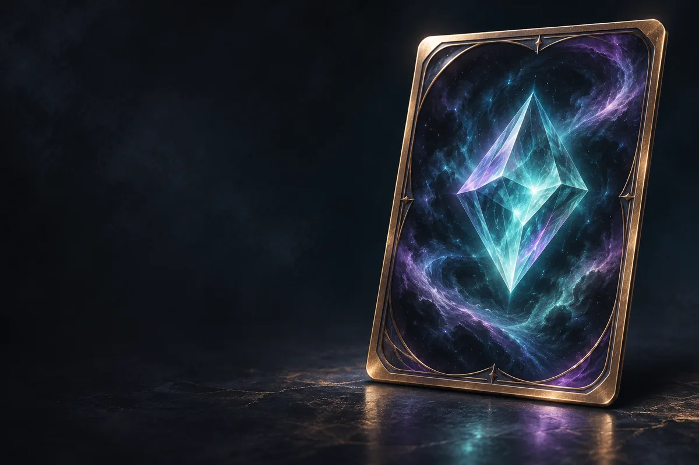
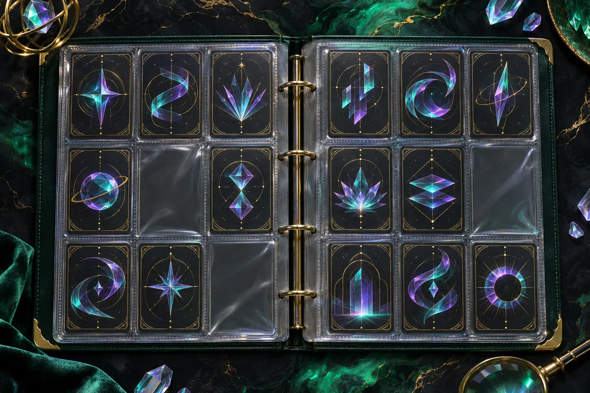

# Extreme Demon Gacha | Demon Pack Lab

[Play Extreme Demon Gacha](https://extremedemongacha.games/) in your browser. Open the quick guide during play to look up a card or check its drop odds, then return to the same game.

## Find your next card

- [Browse the practice collection](https://extremedemongacha.games/cards/) to discover 48 original cards, open three-card practice packs, and save your favorites.
- [Read the card and odds guide](https://extremedemongacha.games/guide/) to compare seven reference rarity tiers, search by name or rank, and estimate your chance of a pull across multiple packs.
- [See Lightspill's card preview](https://extremedemongacha.games/cards/lightspill/) or [watch the GRIEF verification](https://extremedemongacha.games/cards/grief/) from the card's own detail page.

Demon Pack Lab is an independent game guide and practice collection. The arcade and the practice collection each use their own card pool and progress.
